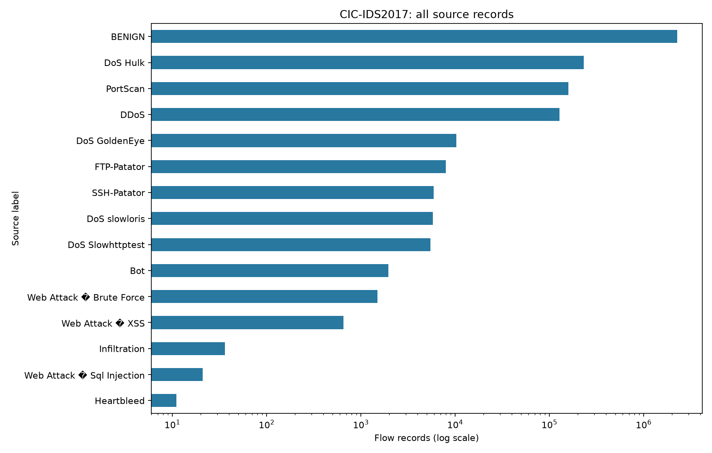

# CIC-IDS2017 project suitability

## Recommendation

Use this dataset for the graduate project's offline binary baseline and selected attack classification. Treat live detection as a separate validation milestone: CSV performance alone cannot establish real-network effectiveness.

## Actual inspection

Revision: `b33f3052398ffd63463ce3120fec2acbb68e2ff6`. Generated UTC: 2026-11-12T01:29:14.667584+00:00.
Full scan of every source CSV, in batches of 25000; no preprocessing or training.
Examined 2,830,743 records across 8 files, with 78 features and one label column.
BENIGN: 2,273,097 (80.30%); attack-labeled: 557,646 (19.70%). An always-BENIGN classifier would score 80.30% accuracy.

| Observed source label | Records | Share |
|---|---:|---:|
| BENIGN | 2,273,097 | 80.3004% |
| DoS Hulk | 231,073 | 8.1630% |
| PortScan | 158,930 | 5.6144% |
| DDoS | 128,027 | 4.5227% |
| DoS GoldenEye | 10,293 | 0.3636% |
| FTP-Patator | 7,938 | 0.2804% |
| SSH-Patator | 5,897 | 0.2083% |
| DoS slowloris | 5,796 | 0.2048% |
| DoS Slowhttptest | 5,499 | 0.1943% |
| Bot | 1,966 | 0.0695% |
| Web Attack � Brute Force | 1,507 | 0.0532% |
| Web Attack � XSS | 652 | 0.0230% |
| Infiltration | 36 | 0.0013% |
| Web Attack � Sql Injection | 21 | 0.0007% |
| Heartbleed | 11 | 0.0004% |

## Coverage by file

| File | Records | Labels |
|---|---:|---|
| Friday-WorkingHours-Afternoon-DDos.pcap_ISCX.csv | 225,745 | BENIGN, DDoS |
| Friday-WorkingHours-Afternoon-PortScan.pcap_ISCX.csv | 286,467 | BENIGN, PortScan |
| Friday-WorkingHours-Morning.pcap_ISCX.csv | 191,033 | BENIGN, Bot |
| Monday-WorkingHours.pcap_ISCX.csv | 529,918 | BENIGN |
| Thursday-WorkingHours-Afternoon-Infilteration.pcap_ISCX.csv | 288,602 | BENIGN, Infiltration |
| Thursday-WorkingHours-Morning-WebAttacks.pcap_ISCX.csv | 170,366 | BENIGN, Web Attack � Brute Force, Web Attack � XSS, Web Attack � Sql Injection |
| Tuesday-WorkingHours.pcap_ISCX.csv | 445,909 | BENIGN, FTP-Patator, SSH-Patator |
| Wednesday-workingHours.pcap_ISCX.csv | 692,703 | BENIGN, DoS slowloris, DoS Slowhttptest, DoS Hulk, DoS GoldenEye, Heartbleed |

## Quality findings

- Missing cells: 1,358; infinite numeric cells: 4,376.
- Rows with any nonfinite or unparseable feature: 2,867.
- Numeric parse failures among nonmissing features: 0.
- Duplicate row fingerprint estimate beyond first occurrence: 308,381. 64-bit row fingerprints of string values, including label; collision risk and dtype formatting mean this is an estimate, not exact row equality.
- Constant numeric features: {' Bwd PSH Flags': 0.0, ' Bwd URG Flags': 0.0, 'Fwd Avg Bytes/Bulk': 0.0, ' Fwd Avg Packets/Bulk': 0.0, ' Fwd Avg Bulk Rate': 0.0, ' Bwd Avg Bytes/Bulk': 0.0, ' Bwd Avg Packets/Bulk': 0.0, 'Bwd Avg Bulk Rate': 0.0}.
- Fwd Header Length and Fwd Header Length.1 identical in every batch: True.
- Negative values need feature-specific interpretation; for example, window sizes may use sentinels. Do not discard all negative values blindly.
- Original headers and labels are retained. Review header whitespace and corrupted characters in web-attack labels before encoding.

Detailed per-column counts and source metadata are in `dataset_suitability.json`.

## Implications for this project

1. The observed DDoS, DoS, PortScan, FTP-Patator, and SSH-Patator labels cover the requested attack families. Start with benign versus attack; assess individual classes only where enough examples exist. Heartbleed, Infiltration, and SQL Injection are too scarce for strong standalone claims.
2. Report per-class precision/recall, macro F1, confusion matrices, and benign false-positive rate. Accuracy is insufficient because of imbalance. Sample across files and labels; the initial 10,000-row sample missed all attacks.
3. Resolve duplicate leakage before future splits. Preserve source filename as provenance, not as a model input. This mirror lacks timestamps and source/destination IPs, so exact temporal or host-group splitting is unavailable. File/day holdouts can omit entire attack classes; inspect coverage before choosing an evaluation design.
4. These are flow-level features, not packet-level examples. Scapy capture alone cannot reproduce flow duration, directional statistics, interarrival times, active/idle windows, and TCP features. Define a compatible extractor, direction rules, units, and flow timeout; validate with PCAP replay before live use. Partial flows also differ from completed training flows.
5. This is a controlled 2017 benchmark. Neither high offline accuracy nor these labels establishes performance on present-day traffic or unseen attacks. Published research identifies extraction and labeling problems; assess those limitations in the final report.

## Source context (separate from measured statistics)

- [Original UNB dataset description](https://www.unb.ca/cic/datasets/ids-2017.html): five-day collection, attack schedule, and CICFlowMeter-derived flow features.
- [Engelen et al., troubleshooting study and documentation](https://intrusion-detection.distrinet-research.be/WTMC2021/extended_doc.html): flow construction, labeling, flag counting, and redundant-feature problems. This analysis does not establish that the Hugging Face mirror fixes those problems.

No preprocessing, splitting, model fitting, or live capture was implemented.
