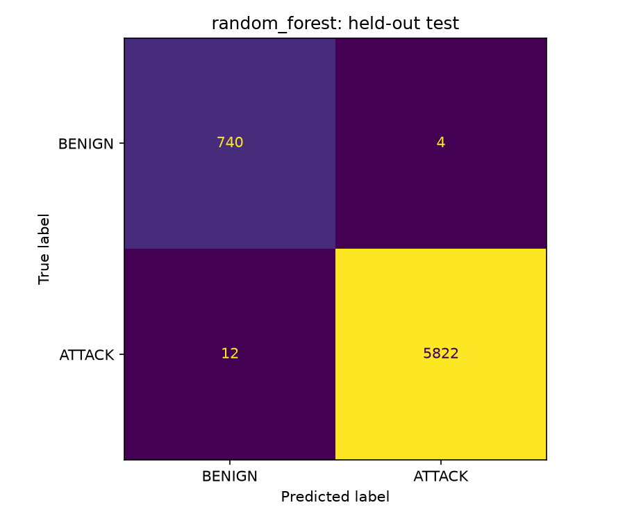

# Phase 3: binary baseline results

Generated UTC: 2026-11-12T04:30:15.745240+00:00
Source revision: `b33f3052398ffd63463ce3120fec2acbb68e2ff6`; seed: 42.

BENIGN=0, ATTACK=1. Fixed default probability decision threshold (0.5); no threshold search or hyperparameter tuning. Both candidates use balanced class weights to account for the attack-heavy development sample.
Models fit training data only, with the Phase 2 training-fitted preprocessing. Selection uses validation macro F1, then lower false-positive rate as a tie-breaker. Nonconverged candidates are ineligible. Only the winner is scored on test; it is not refitted on validation.

## Validation comparison

| Model | Accuracy | Attack precision | Attack recall | Attack F1 | Macro F1 | Benign FPR |
|---|---:|---:|---:|---:|---:|---:|
| logistic_regression | 0.9213 | 0.9863 | 0.9241 | 0.9542 | 0.8375 | 0.1008 |
| random_forest | 0.9973 | 0.9991 | 0.9978 | 0.9985 | 0.9932 | 0.0067 |
| majority_dummy | 0.8869 | 0.8869 | 1.0000 | 0.9401 | 0.4700 | 1.0000 |

Selected: **random_forest**.

## Selected model: test results

- accuracy: 0.997568
- precision_attack: 0.999313
- recall_attack: 0.997943
- f1_attack: 0.998628
- macro_f1: 0.993966
- false_positive_rate: 0.005376
- roc_auc: 0.999839
- average_precision: 0.999979

Confusion matrix: rows=actual, columns=predicted; order BENIGN, ATTACK.
```json
[[740, 4], [12, 5822]]
```



## Limits

This class-capped sample is attack-heavy and is not natural traffic prevalence. Precision, accuracy, and probability estimates must not be treated as deployment performance. Random record splitting cannot rule out session/host/time similarity. Rare source attacks have tiny support. This model predicts only BENIGN or ATTACK, not specific attack types.
The test result is a final baseline measurement, not a tuning target. Future tuning should use validation or training-only cross-validation with fold-local preprocessing; repeated test inspection compromises an untouched evaluation claim.
Saved model includes preprocessing and supports compatible raw flow-feature tables. It does not capture packets or establish live detection performance.

Full metrics, parameters, convergence warnings, fit times, versions, and input hashes: `binary_baseline_metrics.json`.
