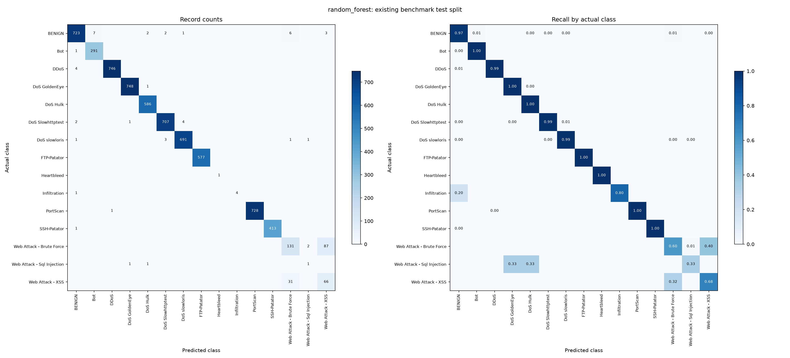

# Phase 3: multiclass baseline

Generated UTC: 2026-11-12T04:42:52.157160+00:00
Source revision: `b33f3052398ffd63463ce3120fec2acbb68e2ff6`; seed: 42.

Both models fit training only with the frozen Phase 2 training-fitted preprocessing. Selection uses validation macro F1 over the full saved label set, then lower benign false-positive rate. Nonconverged candidates are excluded. Predictions use the highest-scoring class; there is no threshold search or hyperparameter tuning. Only the selected model is scored on test, without refitting on validation.
**This is the same benchmark split already evaluated for the binary baseline, not a new independent or untouched test set.**

## Validation comparison

| Model | Accuracy | Macro F1 | Weighted F1 | Benign FPR | Converged |
|---|---:|---:|---:|---:|---|
| logistic_regression | 0.9354 | 0.7983 | 0.9409 | 0.1815 | True |
| random_forest | 0.9769 | 0.9167 | 0.9777 | 0.0134 | True |
| majority_dummy | 0.1140 | 0.0136 | 0.0233 | 1.0000 | N/A |

Selected: **random_forest**.

## Selected model: test results

- accuracy: 0.974916
- macro_f1: 0.887224
- weighted_f1: 0.975828
- false_positive_rate: 0.028226
- attack_detection_recall: 0.998286

Attack detection recall collapses all attacks together; it does not measure correct attack-type identification.

| Class | Precision | Recall | F1 | Test support |
|---|---:|---:|---:|---:|
| BENIGN | 0.9864 | 0.9718 | 0.9790 | 744 |
| Bot | 0.9765 | 0.9966 | 0.9864 | 292 |
| DDoS | 0.9987 | 0.9947 | 0.9967 | 750 |
| DoS GoldenEye | 0.9973 | 0.9987 | 0.9980 | 749 |
| DoS Hulk | 0.9932 | 1.0000 | 0.9966 | 586 |
| DoS Slowhttptest | 0.9930 | 0.9902 | 0.9916 | 714 |
| DoS slowloris | 0.9928 | 0.9914 | 0.9921 | 697 |
| FTP-Patator | 1.0000 | 1.0000 | 1.0000 | 577 |
| Heartbleed | 1.0000 | 1.0000 | 1.0000 | 1 |
| Infiltration | 1.0000 | 0.8000 | 0.8889 | 5 |
| PortScan | 1.0000 | 0.9986 | 0.9993 | 729 |
| SSH-Patator | 1.0000 | 0.9976 | 0.9988 | 414 |
| Web Attack - Brute Force | 0.7751 | 0.5955 | 0.6735 | 220 |
| Web Attack - Sql Injection | 0.2500 | 0.3333 | 0.2857 | 3 |
| Web Attack - XSS | 0.4231 | 0.6804 | 0.5217 | 97 |

## Largest attack-type confusions

| Actual | Predicted | Records |
|---|---|---:|
| Web Attack - Brute Force | Web Attack - XSS | 87 |
| Web Attack - XSS | Web Attack - Brute Force | 31 |
| BENIGN | Bot | 7 |
| BENIGN | Web Attack - Brute Force | 6 |
| DDoS | BENIGN | 4 |
| DoS Slowhttptest | DoS slowloris | 4 |
| BENIGN | Web Attack - XSS | 3 |
| DoS slowloris | DoS Slowhttptest | 3 |
| BENIGN | DoS Hulk | 2 |
| BENIGN | DoS Slowhttptest | 2 |
| DoS Slowhttptest | BENIGN | 2 |
| Web Attack - Brute Force | Web Attack - Sql Injection | 2 |
| BENIGN | DoS slowloris | 1 |
| Bot | BENIGN | 1 |
| DoS GoldenEye | DoS Hulk | 1 |

## Limits and validation

Test classes with fewer than 20 records (descriptive flag, not a statistical guarantee): {'Heartbleed': 1, 'Infiltration': 5, 'Web Attack - Sql Injection': 3}
A perfect score with one or a handful of examples is weak evidence. Zero-support classes, if any, receive zero in the fixed-label macro F1; inspect support alongside scores. Macro F1 weights tiny and common classes equally, while weighted F1 can hide rare-class failures.
Class-capped sampling changes prevalence; this is a development benchmark. Random record splits retain possible session, host, and time similarity. These results do not establish performance on unseen attacks or current live traffic. Scores from predict_proba are uncalibrated.
The saved bundle includes preprocessing, the selected classifier, and the original label mapping. Reloaded raw-input predictions and probability arrays are checked against the evaluated model. Input and model SHA-256 hashes are recorded. The notebook reads saved results and uses validation rows for inference; it does not rescore test.
Do not tune against these test results. Any follow-up tuning should use validation or training-only cross-validation with fold-local preprocessing. Live packet capture and PCAP feature extraction remain unimplemented.

Full parameters, warnings, fit times, package versions, per-class metrics, and provenance: `multiclass_baseline_metrics.json`.
